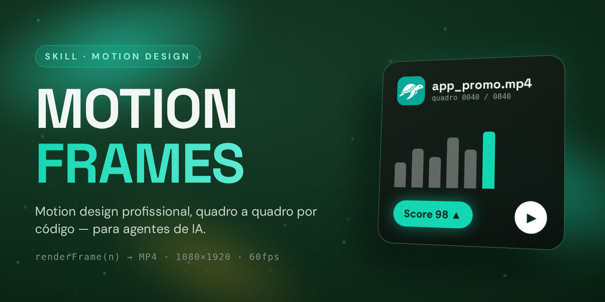

# Motion Frames

**Skill que ensina seu agente de IA a criar vídeos de motion design profissionais** — verticais, 1080x1920, 60fps, para TikTok, Reels e anúncios.

## O que ela sabe

- **Criar animação por código**, quadro a quadro (`renderFrame(n)`) — sincronizável com narração, palavra por palavra.
- **4 estilos**: cinema/morph, promo premium de app, cena interativa sem cortes e anúncio de tipografia clara.
- **As regras do motion profissional**: tipografia protagonista, micro-evento a cada 0,5–1,5s, morphs, fundo vivo com profundidade e som em cada animação.
- **Usar a identidade real da marca**: logo, cores e fontes do site do produto.
- **O pipeline completo** até o MP4 — e os erros a não repetir.

## Como instalar (o jeito fácil)

**Passo 1 — Baixe o zip desta skill.**

**Passo 2 — Jogue o zip no chat do seu agente de IA.**

**Passo 3 — Peça:** *"usa essa skill para criar um vídeo sobre…"*

**Pronto** — o agente faz o resto.

## Feitos com ela

**TurtlePags** (53s) · **Feito com Muse** (14s) · **Kalo** (15s) · **iPhone 18 Pro** (53s)
